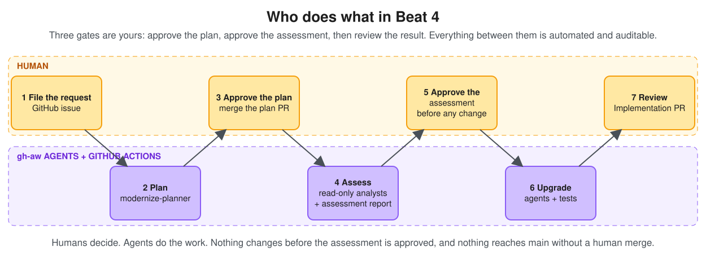

# Beat 4 debrief - multi-agent Java modernization with human gates

**In one sentence:** a GitHub issue became a reviewed plan, a team of small agents upgraded a Java 8 app to Java 21 and tested it, and a human decided what reached `main`.

> Editable source: [assets/beat-4-who-does-what.excalidraw](assets/beat-4-who-does-what.excalidraw)

## What the customer just saw

| # | What happened | Who decided |
|---|---|---|
| 1 | A GitHub issue stated the outcome and the boundaries: Java 21, Spring Boot 3.5, no Azure migration. | Human |
| 2 | A planner agent inspected Asset Manager and opened a plan pull request. | Agent proposed, human reviewed |
| 3 | The human merged the plan. The merge is the approval. | **Human gate 1** |
| 4 | Five agents and a few plain Actions jobs upgraded the code, ran the tests, and checked the result against the plan. | Automated and auditable |
| 5 | An Implementation Pull Request arrived with test evidence and a review verdict. | **Human gate 2** |

Nothing reaches `main` unless a human merges it.

## The pipeline

> Editable source: [assets/beat-4-pipeline.excalidraw](assets/beat-4-pipeline.excalidraw)

Read it left to right in three steps:

1. **Assess in parallel.** `baseline-test`, `modernize-compat-analyst` and `modernize-dependency-analyst` run side by side. They only read.
2. **Upgrade in sequence.** `modernize-build-upgrader` changes the Maven files. Then `modernize-code-fixer` changes the Java code until it builds and the tests pass. One writer at a time, on one branch.
3. **Verify in parallel, then review.** `verify-build` and `verify-static` run side by side. `modernize-conformance-reviewer` then compares the result with the approved plan.

## Meet the agents

Each agent has one name everywhere: its workflow file, its entry in the Actions sidebar, its job in the run graph, and its custom agent file.

| Agent | Reads or writes | What it produces |
|---|---|---|
| `modernize-planner` | Reads code, opens a plan PR | The Modernization Plan |
| `modernize-compat-analyst` | Read-only | A comment: `javax` to `jakarta` and Spring Boot 3 changes |
| `modernize-dependency-analyst` | Read-only | A comment: dependency and Maven wrapper decisions |
| `modernize-build-upgrader` | Pushes a commit | Updated `pom.xml` files |
| `modernize-code-fixer` | Pushes commits | Updated source and tests |
| `modernize-conformance-reviewer` | Updates the PR description, one comment | A verdict and the PR summary |

Plain Actions jobs, not agents, do the baseline tests, the JDK 21 build and test run, the version checks, and the final hand-off. Where a result can be computed, it is computed. Agents handle judgment.

## Why several agents instead of one

Think of it like small services instead of one monolith.

- **Faster.** Analysis and verification run in parallel.
- **Safer.** Each agent has one job and the least access it needs. The analysts cannot change code.
- **Easier to track.** Each stage is its own job with its own log and a row in the tracker comment.
- **Easier to recover.** A failed stage can be re-run alone. Earlier commits stay on the branch.

## Where the human stays in control

1. **Merge the plan** to authorize the work.
2. **Review the Implementation Pull Request** and merge or reject it.

Along the way:

- Agents never write to the repository directly. A separate, validated job pushes their commits.
- The Implementation PR stays a **draft** until the checks pass.
- `modernize-conformance-reviewer` states in writing whether the result matches the plan.

## Where the code lives

| Location | Contents |
|---|---|
| `main` | The original Java 8 / Spring Boot 2.7 code. Agents never touch it. |
| `modernize/issue-<N>` | The modernized Java 21 / Spring Boot 3.5 code. |
| Implementation Pull Request | The review surface for the branch. Merging it is the only way the new code reaches `main`. |

## What if something fails

| Failure | What you see | Recovery |
|---|---|---|
| A test fails after the upgrade | `verify-build` is red; the tracker shows baseline versus final | Re-run `modernize-code-fixer` |
| An agent cannot finish | That job is red; the branch still holds earlier work | Re-run the failed job from the Actions run |
| The plan is wrong | The pipeline has not started yet | Reject the plan PR and file a new request |

## Be honest about the boundaries

- This pipeline **copies the plan, execute, validate pattern** of GitHub Copilot app modernization. It uses our own agents and standard Maven commands. It does not run that product, and it is not a supported product feature.
- The baseline has one failing worker test (Mockito cannot mock a final AWS class on Java 8). The pipeline records it first and compares against it. Whether the upgrade makes it pass is a result to report, not a promise.
- Agent behavior is proven by running it. The pre-run you showed is that proof.

## What to have open on screen

1. The Modernization Request issue.
2. The plan pull request and its plan file.
3. The pipeline run graph in Actions.
4. One agent run, to show a read-only job and a separate validated write.
5. The Implementation Pull Request: tracker comment, test comparison, reviewer verdict.

## Questions you may get

**Is this the Copilot app modernization product?**
No. It follows the same plan, execute, validate pattern with gh-aw agents. The product remains the supported route for production work.

**Can it run without a human?**
It could. This demo deliberately keeps two gates. The approval model does not change if you add more stages.

**What if an agent is wrong?**
`modernize-conformance-reviewer` checks the diff against the plan, deterministic jobs run the tests, and a human reviews before anything reaches `main`.

**Why not one big agent?**
Parallel work, least privilege, and per-stage recovery. The same reasons teams split services.

## Customer takeaway

> We did not ask an agent to modernize production code without oversight. We captured intent, reviewed the plan, let a team of small agents do the work in parallel where it was safe, and received reviewable code with test evidence. The next stages can be added later without changing this approval model.

## Deliberately deferred

- Azure Database for PostgreSQL migration
- Azure Blob Storage migration
- Azure Service Bus migration
- Containerization
- Azure deployment
- CI/CD quality gates
- Production observability and feedback
