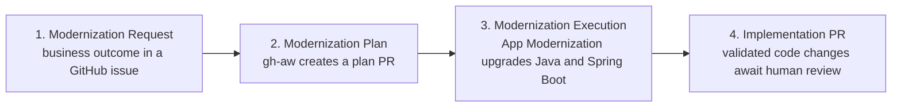

# Beat 4 debrief - human-gated Java modernization

## What the customer just saw

Beat 4 demonstrated only the first four stages of a larger modernization journey:

Testing agents, AI review, CI/CD gates, deployment, and production feedback were intentionally not part of this first customer demo.

## The simple story

| Stage | What happened | Who controlled the decision |
|---|---|---|
| 1. Request | A GitHub issue stated the business outcome and boundaries. | Human |
| 2. Plan | gh-aw inspected Asset Manager and opened a Markdown plan pull request. | Agent proposed; human reviewed |
| 3. Modernize | GitHub Copilot app modernization upgraded Java 8 to 21 and Spring Boot 2.7 to 3.5. | Human launched the approved task |
| 4. Review | The validated changes were pushed as an implementation pull request. | Human decides whether to merge |

## Why two agent surfaces were used

GitHub Agentic Workflows and GitHub Copilot app modernization have different jobs:

- **gh-aw** turns repository intent into an auditable, reviewable plan.
- **GitHub Copilot app modernization** performs the supported Java upgrade and its validation/fix loop.

Beat 4 does not pretend that the VS Code modernization extension runs inside GitHub Actions. The handoff after plan approval is explicit and visible.

## Where the human stays in control

The human makes both irreversible decisions:

1. Merge the Modernization Plan pull request to authorize implementation.
2. Merge or reject the Implementation Pull Request after reviewing the code and validation evidence.

The human does not need to write modernization code during the demo. The modernization agent owns analysis, changes, build repair, and test repair.

## What made the demo recoverable

The official Asset Manager workshop includes product-maintained checkpoint branches:

- `main` - original Java 8 / Spring Boot 2.7 application.
- `workshop/java-upgrade` - known-good state after the runtime and framework upgrade.
- `workshop/expected` - later Azure service migration state, outside this demo.

If a live upgrade needs troubleshooting, compare with `workshop/java-upgrade` or use that checkpoint to explain the expected result.

## What to show on screen

1. The Modernization Request issue.
2. The generated Markdown plan and its merged pull request.
3. The App Modernization assessment and upgrade progress.
4. The Implementation Pull Request, changed files, and validation summary.

## Customer takeaway

> We did not ask an agent to modernize production code without oversight. We captured intent, reviewed the plan, authorized a supported modernization tool, and received reviewable code changes. The next stages can be added later without changing this approval model.

## Deliberately deferred

- Azure Database for PostgreSQL migration
- Azure Blob Storage migration
- Azure Service Bus migration
- Custom modernization skills
- Containerization
- Azure deployment
- CI/CD quality gates
- Production observability and feedback
