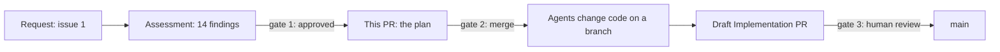
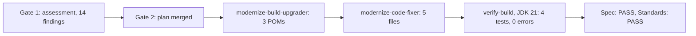

# Pull request description

Every pull request the modernization workflows write uses this body. Keep prose short and start with the content. No preamble, no closing remarks.

This is the modernization profile of the `pr` skill (Summary, Evidence, Merge Danger) and the `show-me` skill (the smallest visual that makes the point: Mermaid flow, `diff` sketch, file tree, call tree). Follow both; this skill adds the values and examples for this pipeline. The writing rules come from `unslop`.

Every issue comment and pull request this pipeline writes carries at least one `show-me` visual next to the text it supports. Pick the one that fits: a Mermaid flow for stages and gates, a `diff` sketch for versions and imports, a file tree for changed paths, a table only for lists of findings.

## Body shape

```markdown
## Summary

<one or two sentences, then one to three small visuals>

## Evidence

- **Before:** <what the repository or the baseline run shows now>
  **After:** <what must be true, or is true, after this change>

## Merge Danger

**Door:** <one-way or two-way, and for what>

<one or two sentences>

**Blast Radius:** <one word>

<one or two sentences>
```

Fill every value from files you read or results you were given. Never copy an example value without checking it.

## Summary

Pick the smallest view that makes the point. Use at most three.

- Flow between pull requests or stages: a Mermaid `flowchart LR`. Quote every label. Write "issue 12", not "#12", because Mermaid reads `#` as an entity.
- What changes and the surrounding shape already exists: a `diff` block.
- Who runs in what order: an indented text tree, with `in parallel` notes.

Plan pull request, example for issue 1:

````markdown
Plan for issue 1: upgrade Asset Manager from Java 8 and Spring Boot 2.7.18 to Java 21 and Spring Boot 3.5.16. The assessment report in this pull request was approved by @octocat (gate 1). This pull request adds `plan.md` next to it and changes no application code. Merging it is gate 2 and starts the agents that change code.



What the plan proposes to change later, not in this pull request:

```diff
 asset-manager/
-  java.version                  8
+  java.version                  21
-  spring-boot-starter-parent    2.7.18
+  spring-boot-starter-parent    3.5.16
-  javax.* imports (5 files)
+  jakarta.* imports             javax.imageio stays, it ships with the JDK
```

```text
modernize-pipeline (starts on merge)
  modernize-build-upgrader           D-01 D-02 D-04
    modernize-code-fixer             C-01 to C-07
  verify-build, verify-static        in parallel, no AI
  modernize-conformance-reviewer     in parallel (spec)
  modernize-standards-reviewer       in parallel (standards)
```
````

Implementation pull request, example for issue 3. Lead with what changed and the result, then show the stages and the changed paths:

````markdown
Upgrades Asset Manager from Java 8 and Spring Boot 2.7.18 to Java 21 and Spring Boot 3.5.16, as approved in the plan for issue 3. Five files move from `javax.*` to `jakarta.*`. Tests pass on JDK 21 with no errors, and known advisories drop from 168 to 41.



```diff
 asset-manager/
-  pom.xml                       java 8, boot 2.7.18
+  pom.xml                       java 21, boot 3.5.16
   web/.../WebMvcConfig.java     jakarta.servlet, WebMvcConfigurer
   web/.../ImageMetadata.java    jakarta.persistence
   worker/.../ImageMetadata.java jakarta.persistence
```
````

Always include the Mermaid flow. Use real numbers from the assessment, the verification comment and the diff, never the example's.

## Evidence

Show a before and after with real values.

- Plan pull request. Before: the versions, test results and finding counts from `assessment.md`, with file paths. After: the checks the Implementation pull request must pass, taken from the plan's Validation section. The planner does not run tests, so say that.
- Implementation pull request. Before: the baseline from `evidence/facts.json`. After: the totals from the verification comment, plus the verdict of each check. If the final totals are worse than the baseline, say so first.
- Put any check that is Not met or Cannot verify directly under the before and after, in a short list. Put the full traceability table inside a collapsed block so the page stays short:

````markdown
<details>
<summary>Finding traceability (14 of 14 checked)</summary>

| Finding | Status | Commit |
|---|---|---|
| D-01 Spring Boot parent 3.5.16 | Met | a1b2c3d |

</details>
````

## Merge Danger

- Door. Two-way means a revert undoes it. One-way means it cannot be undone, such as spent AI credits or a deleted branch. A change can be both. Say which part is which.
- Blast Radius. One word, then the real consequence in a sentence. Consider what breaks for people who build or deploy from the branch.

Plan pull request: two-way for code, one-way for spend. The pipeline never writes to `main`. Reverting the merge removes the plan and assessment files but not the AI credits the pipeline already used. State the cost estimate from the plan. Blast radius is `Contained`.

Implementation pull request: two-way. Merging replaces the Java 8 code on `main` with Java 21 code, and a revert restores it. Anyone building `main` then needs JDK 21. Pick the blast radius word from what the diff shows.

## Agent comments

The analyst comments on the request issue and the reviewer comments on the pull request follow the same style, in a shorter form.

- Start with the marker line the task names, such as `<!-- modernize:compat -->`, then one sentence with the result and a count.
- Use at most one table, at most 10 rows. Put extra rows inside a collapsed `<details>` block.
- Do not bold anything inside a table. Write ranks as plain words: Blocker, Change, Watch, No change.
- Add a small visual only when it shortens the text, such as a diff of the version changes.
- When the task asks for a `json` block, put it last, make it valid JSON, and do not wrap it in `<details>`. The pipeline parses it.
- Use sentence case headings. Follow the writing rules below.
## Writing rules

- Use plain words. "Use", not "utilize". "Because", not "due to the fact that".
- No em dashes, no en dashes. Use a period or a comma.
- No emojis, no decorative bold. Bold only the template labels.
- Sentence case headings, except the three template headings.
- Active voice. Name who acts: "the pipeline pushes to the branch".
- No filler such as "ensuring", "leveraging", "robust", "seamless". No closing summary.
- No "not just X, but Y". State the point.
- No colon as a mid-sentence connector. Use a colon only before a list or an example.
- Use one word for one thing. Do not cycle synonyms.
- Say what the change does, with a number or a path. Cut any sentence that could appear unchanged in another project.
